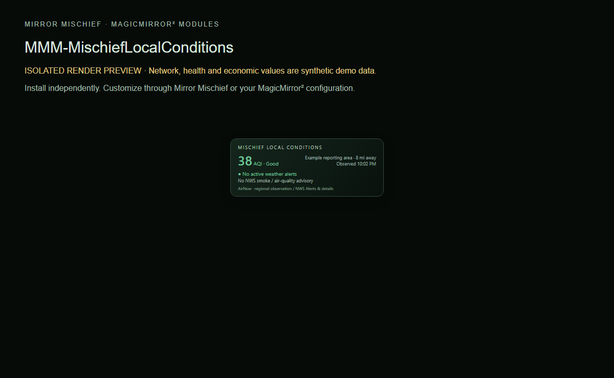

# MMM-MischiefLocalConditions

Regional US air quality observations and active NWS weather alerts.

Part of [Mirror Mischief](https://github.com/FoggEyez/Mirror-Mischief). Install and configure manually, or use the optional companion.



Screenshot uses the actual module renderer in an isolated preview. Network/health/economy readings are labelled synthetic demonstration data, not live readings.

## Install

Requires a working MagicMirror² installation, Node.js 22 or newer, and a current browser. Development baseline: MagicMirror² 2.38.0 API. Physical-device compatibility of this newly packaged version remains to be verified; see VALIDATION.md.

```sh
cd ~/MagicMirror/modules
git clone https://github.com/FoggEyez/MMM-MischiefLocalConditions.git
```

No npm runtime dependencies or install scripts. No extra services are required.

Add this to the modules array in config/config.js, then restart MagicMirror²:

```js
{
  module: "MMM-MischiefLocalConditions",
  position: "top_left",
  config: {}
}
```

## Customize

Enter your latitude and longitude, then set `locationConfigured: true`. No requests run before this explicit setup step. Coordinates are sent to NWS; AirNow data is downloaded and matched locally within 100 km. Set `timeZone` or leave it empty for local system time. No nearby current observation displays unavailable, not an invented AQI. Observations older than three hours and alert checks older than ten minutes are marked unavailable. Use official NWS information for decisions; this module is an informational display.

All supported settings are visible as literal defaults for generated settings editors.

| Setting | Default | Type |
| --- | --- | --- |
| latitude | `0` | number |
| longitude | `0` | number |
| locationConfigured | `false` | boolean |
| timeZone | `""` | string |
| panelWidth | `350` | number |
| showSmokeAdvisories | `true` | boolean |
| showObservedTime | `true` | boolean |
| maxAlerts | `3` | number |

## Mirror Mischief companion

Part of [Mirror Mischief](https://github.com/FoggEyez/Mirror-Mischief), a companion designed to make module installation, settings and layout easier. See [MIRROR-MISCHIEF.md](MIRROR-MISCHIEF.md) for setup and availability.

In Mirror Mischief, choose Install from a link, paste this repository URL, then open Module settings. Set your preferences and position, save and run Check setup. The repository folder, JavaScript entry and Module.register name match exactly. companion.json describes supported placement and dependencies; the current companion reads defaults from JavaScript, not this manifest. One instance per mirror is supported in this release; helpers share one configuration per module. For renamed legacy modules, install this version turned off first and disable the legacy counterpart before enabling it. Moon and Quotes retain their existing names: back up and review any local changes before updating their existing folders. No automatic config migration or removal occurs. Ordinary MagicMirror² configuration works without the companion.

## APIs, privacy and cost

[AirNow public reporting feed](https://files.airnowtech.org/airnow/today/reportingarea.dat) and [National Weather Service alerts](https://www.weather.gov/documentation/services-web-api). No key or paid account required. US regional coverage; not a worldwide weather service. AirNow requests every 15 minutes, NWS every 2 minutes. Providers may limit or change availability.

No telemetry or analytics is added by Mischief. Keep private configuration, tokens and collector snapshots outside this repository.

## Update or remove

Review CHANGELOG.md, back up your private config and local customizations, then run git pull --ff-only inside this module folder and restart MagicMirror². To remove, disable/remove its config entry and restart; retain the folder for rollback or uninstall it using your companion. Never overwrite private configuration from an example.

## Development and support

Run npm ci and npm test. See CONTRIBUTING.md and VALIDATION.md. Report reproducible issues through this repository's Issues tab; remove secrets and private addresses.

## Credits and license

Original Mischief parsing/rendering. Data credits: AirNow / US EPA and National Weather Service. Provider data is not relicensed by the module MIT license.

Original Mischief code: MIT, Copyright 2026 FoggEyez. Third-party licenses and data credits remain applicable; see THIRD_PARTY_NOTICES.md.
